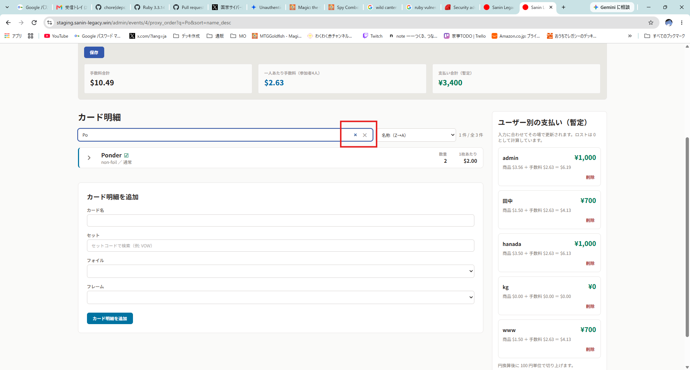
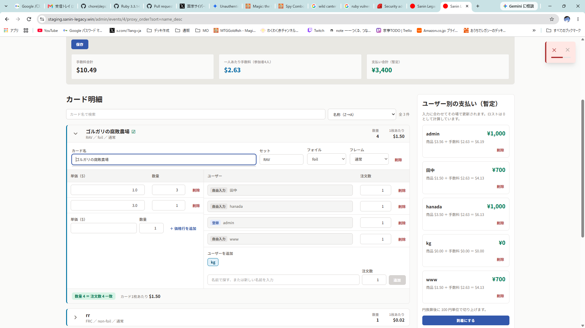

# スマホビューのブレ（PWAだけかも？ブラウザも要確認）
- スマホのレイアウトがちぐはぐ、常に拡大率は一定であり画面は無駄に横スクしないこと
- スマホでapiログインできない(High Priority)

# 手数料計算の変更
- 関税・消費税・決済手数料は絶対的な金額でなく％で持たせる（High Priority）
    - 金額計算は以下
        - ((商品代金 + 送料) * Paypal手数料 * 円ドルレート * 消費税率 * 関税).ceil(100)
        - 各注文者ごとに上記を計算する
        - 送料は今まで通り、絶対金額を等分する
- 支払合計（円）の左に支払合計（$）を追加

# 絞り込み後の検索欄
- キーワード削除ボタンと絞り込み解除ボタンが両方×でわからない
  - 
  - 絞り込み解除ボタンは日本語で「絞り込み解除」と書くこと

# カード名編集の不具合
- すでにカード名が入力されているフォームに不正な値を入力すると、エラー文が何も出ない
  - 